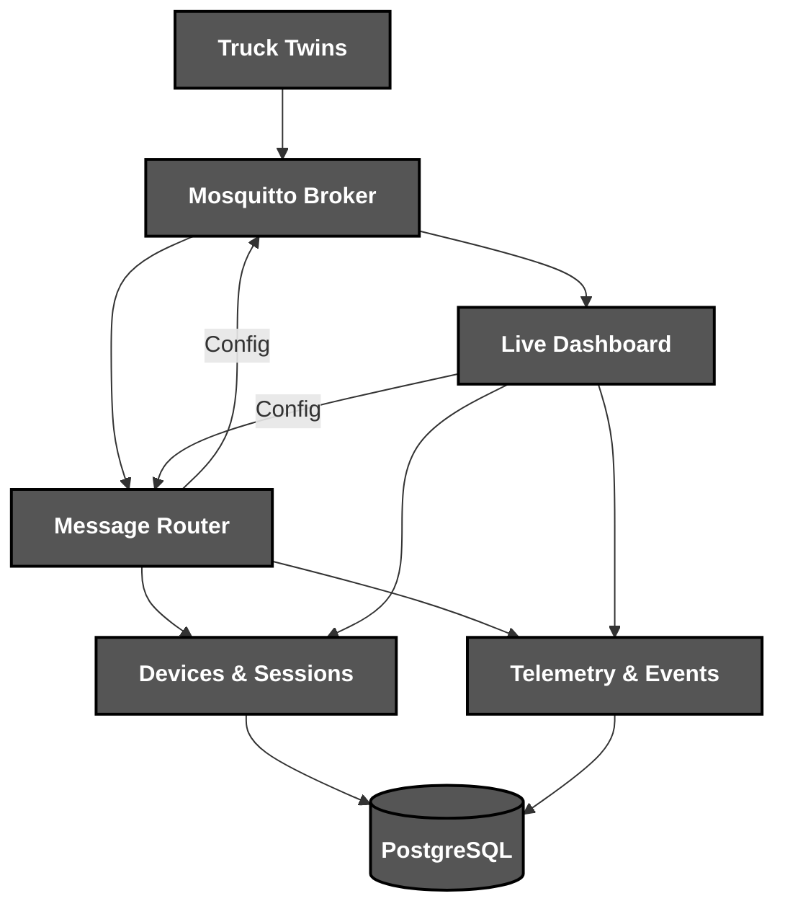
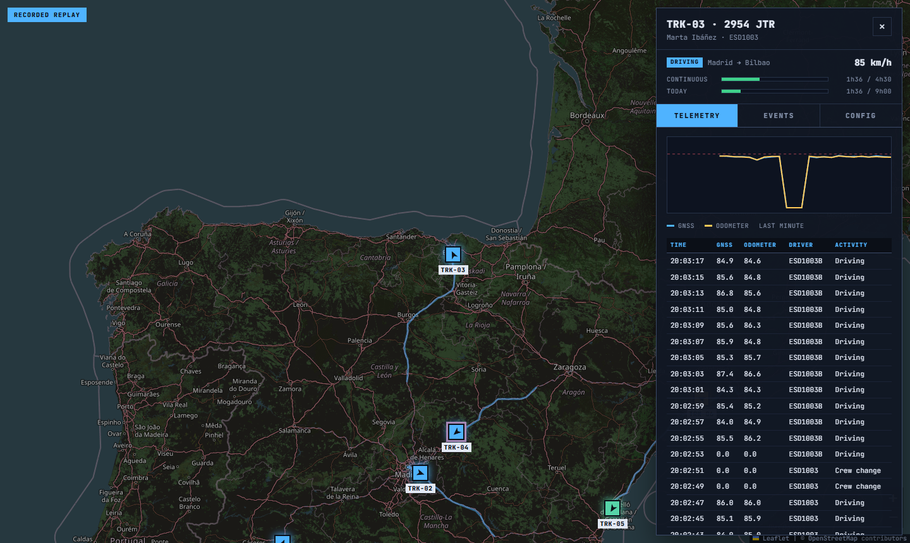

<div align="center">

<br><br>


*A **digital twin** of a truck fleet with live **tachograph** telemetry*

**[▶️ See it live](https://cristiangilsanz.github.io/road-log/)**

</div>

# 📝 **Description**

<div align="center">

***Road Log*** is a **fleet telemetry platform** that simulates trucks with digital tachographs, streams their data over ***MQTT*** and checks every driver against the ***EU driving-time rules***
</div>
<br>
<div align="right">

***It was born as a fourth-year university project*** 🎓

</div>

# 🛠️ **Road Log Architecture & Workflow**

<div align="center">


</div>

# 📁 **Project Structure**

```
road-log/
├── .dockerignore                                       # Docker Build Exclusions
├── .gitattributes                                      # Git Attributes Configuration
├── .gitignore                                          # Git Ignore Rules
├── docker-compose.yml                                  # Whole Fleet in One Command
├── Dockerfile                                          # Image for Every Python Service
├── LICENSE                                             # Project License
├── pyproject.toml                                      # Package & Tool Configuration
├── README.md                                           # You are here! ⬅️
│
├── .github/workflows/
│   ├── ci.yml                                          # Lint, Test & Live Fleet Pipeline
│   └── pages.yml                                       # Replay Site Deployment
│
├── assets/                                             # Visual Assets
│   ├── dashboard.png                                   # Dashboard Screenshot
│   └── logo.png                                        # Road Log Logo
│
├── broker/                                             # Mosquitto with Users & ACLs
│
├── scripts/
│   ├── build_site.py                                   # Replay Site Builder
│   ├── fetch_routes.py                                 # Road Routes from OpenStreetMap
│   └── smoke.sh                                        # End-to-End Fleet Check
│
├── site/                                               # Recorded Session & Replay Player
│
├── src/roadlog/
│   ├── cli.py                                          # One Entry Point per Role
│   ├── geo.py                                          # Distances & Headings
│   ├── routes.py                                       # Real Motorway Routes
│   ├── rules.py                                        # EU Driving-Time Rules
│   ├── messages.py                                     # MQTT Topics & Contracts
│   ├── router.py                                       # MQTT to Microservices Bridge
│   ├── recorder.py                                     # Session Recorder for the Replay
│   ├── twin/                                           # Vehicle, Control Unit & Device
│   ├── services/                                       # Devices, Sessions, Telemetry & Events
│   ├── dashboard/                                      # Live Map & WebSocket Gateway
│   └── data/routes.json.gz                             # Eight Bundled Routes
│
└── tests/                                              # Unit & Service Tests
```

# 🔧 **Installation**

## 📋 Requirements

- **Docker** with **Docker Compose**

## ⚙️ Quick Setup

1. **Clone the repository**
   ```bash
   git clone https://github.com/cristiangilsanz/road-log.git
   cd road-log
   ```

2. **Start the fleet**
   ```bash
   docker compose up --build
   ```

3. **Open the dashboard** at [http://localhost:8088](http://localhost:8088)

<br>

# 🚀 **See *Road Log* in Action**

<div align="center">
  <a href="https://cristiangilsanz.github.io/road-log/"></a>
</div>

## 🚚 To Watch the Fleet:

1. **Six trucks drive real motorways between Spanish cities, a minute of road every second:**

```bash
docker compose up --build
```

2. **Run more trucks or a faster clock:**

```bash
TRUCKS=8 SIM_SPEED=240 docker compose up --build
```

3. **Click a truck on the map to see its status, driving time, Telemetry of the last minute, Events of the last five minutes and Config**

## ⚙️ To Reconfigure a Tachograph:

1. **Open Config, set new rates and press Assign, or call the API:**

```bash
curl -X POST localhost:8088/api/vehicles/TRK-01/config \
  -H "Content-Type: application/json" \
  -d '{"telemetry_interval": 1, "sampling_interval": 0.5}'
```

2. **The router stores the change and sends it over MQTT, and the truck reports at the new rate within a second**

## 🎬 To Record a New Replay:

1. **Record fifteen minutes of the running fleet:**

```bash
docker compose exec dashboard road-log record --seconds 900 --out /tmp/recording.json
docker compose cp dashboard:/tmp/recording.json site/recording.json
```

2. **Every push to main publishes the replay to GitHub Pages**

## 🧪 To Run the Tests:

1. **Install the package with the development tools:**

```bash
pip install -e ".[dev]"
```

2. **Run the tests and the linter:**

```bash
pytest
ruff check .
```

3. **Check the whole running fleet end to end:**

```bash
docker compose up -d --build && scripts/smoke.sh
```

## ⚖️ Driving Rules

<div align="center">

| Event | Severity | Rule |
|:---:|:---:|---|
| `speeding` | Warning | Trucks may not exceed 90 km/h |
| `sensor-mismatch` | Warning | GNSS and odometer speeds differ by more than 5% |
| `no-card` | Infringement | The truck moves without a driver card |
| `break-due` | Info | 4h15 of driving, a break is due in 15 minutes |
| `break-overdue` | Infringement | 4h30 of driving without a 45-minute break |
| `daily-limit` | Infringement | More than 9 hours of driving in a day |

</div>

## 👷 Driver Profiles

<div align="center">

| Profile | Behaviour |
|:---:|---|
| `careful` | Keeps to 84 km/h and takes every break on time |
| `speeder` | Pushes past the 90 km/h limit on motorways |
| `tired` | Skips the break and drives past the daily limit |
| `faulty-odometer` | Drives well but its odometer reads 12% low |
| `forgetful` | Sometimes drives off without inserting the card |

</div>

Every truck has a crew of two drivers with their own cards and clocks, and the co-driver takes over when the shift ends.

## 📡 MQTT Topics

<div align="center">

| Topic | Direction | Purpose |
|:---:|:---:|---|
| `fleet/hello` | Truck → Router | Ask for access and a vehicle |
| `fleet/hello/{host}` | Router → Truck | Grant or refuse access |
| `fleet/presence/{host}` | Truck → Router | Goodbye, or the last will when the link drops |
| `fleet/vehicles/{id}/telemetry` | Truck → Platform | Position, speeds, driver and driving clock |
| `fleet/vehicles/{id}/events` | Truck → Platform | Rule violations as they happen |
| `fleet/vehicles/{id}/config` | Router → Truck | New telemetry and sampling rates |

</div>

# 💡 **Tips for Best Results**

The following tips help you get the most out of ***Road Log***:

> - Run with ***SIM_SPEED=240*** to watch breaks and crew changes within minutes.
> - Follow ***TRK-03***, the tired driver, to see every driving-time infringement.
> - Run ***docker kill road-log-truck-1*** to watch its last will close the session.

# 📚 **Tech Stack & Other Resources**

## 📦 Tech Stack

### 🧩 **Programming Language**
- [Python](https://docs.python.org/3/)

### 📡 **Messaging**
- [Eclipse Mosquitto](https://mosquitto.org/)
- [Eclipse Paho MQTT](https://eclipse.dev/paho/)

### 🌐 **Services**
- [FastAPI](https://fastapi.tiangolo.com/)
- [SQLAlchemy](https://docs.sqlalchemy.org/)
- [PostgreSQL](https://www.postgresql.org/docs/)

### 🗺️ **Maps & Routes**
- [Leaflet](https://leafletjs.com/)
- [OpenStreetMap](https://www.openstreetmap.org/)
- [OSRM](https://project-osrm.org/)

### 🐳 **Deployment**
- [Docker Compose](https://docs.docker.com/compose/)

### 🧪 **Testing**
- [Pytest](https://docs.pytest.org/)

### 🧹 **Code Quality**
- [Ruff](https://docs.astral.sh/ruff/)

### ⚙️ **Continuous Integration**
- [GitHub Actions](https://docs.github.com/actions)

# 🙏 **Credits & Thanks**

This project was created together with ***Paola Herráez Bravo*** 🤝 in our fourth year of university.

Thanks to the *OpenStreetMap* contributors for the road data and map tiles, and to *OSRM* for the routes ✨.

# 📄 **License**

This project is licensed under the MIT License - see the [LICENSE](LICENSE) file for details. Route data © OpenStreetMap contributors, available under the [Open Database License](https://www.openstreetmap.org/copyright).

# 📞 **Get Help & Connect**

- 🐛 [Open an issue](https://github.com/cristiangilsanz/road-log/issues)
- 📧 cristiangilsanz@gmail.com

<div align="center">
  <br>

  **Made with 💖 for the Logistics Community**

  [⭐ Star this repo](https://github.com/cristiangilsanz/road-log) | [🍴 Fork it](https://github.com/cristiangilsanz/road-log/fork)

  <br>

  <a href="https://www.buymeacoffee.com/cristiangilsanz" target="_blank">
    
  </a>

</div>
